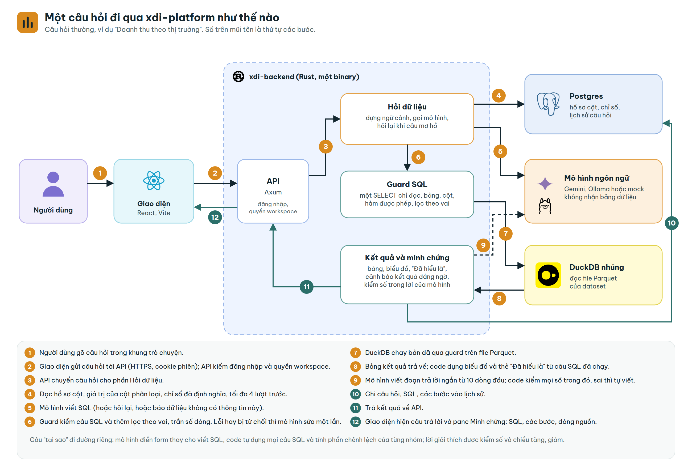

# xdi-platform

Nền tảng phân tích dữ liệu bằng ngôn ngữ tự nhiên: hỏi bằng tiếng Việt, nhận câu trả lời kèm lời giải thích và minh
chứng cho từng con số.

Nạp file CSV, Parquet hoặc Excel rồi gõ câu hỏi. Hệ thống viết SQL, kiểm SQL bằng guard, chạy trên DuckDB và trả về
bảng, biểu đồ cùng câu SQL đã chạy. Với câu hỏi tìm nguyên nhân, như vì sao doanh thu tháng này giảm hay vì sao Europe
cao hơn LATAM, hệ thống tính nhóm nào tạo ra phần lớn chênh lệch; bấm vào một số để xem các dòng dữ liệu đứng sau nó.

Con số do DuckDB tính trên máy của bạn. Mô hình ngôn ngữ viết mô tả cột lúc nạp, viết SQL, điền form cho câu hỏi tìm
nguyên nhân và viết lời. Nó nhận tên cột và danh sách giá trị của cột phân loại, không nhận bảng dữ liệu. Riêng đoạn trả
lời ngắn của câu hỏi thường gửi tối đa 10 dòng đầu của kết quả (với câu không gộp, đó là dòng gốc), tắt bằng
`ANSWER_TEXT=false`. Chi tiết: [docs/PRIVACY.md](docs/PRIVACY.md).

Bản phát hành mới nhất: [v0.2.0](https://github.com/pgiahuy/xdi-platform/releases). Giấy phép Apache 2.0.
Tài liệu: https://pgiahuy.github.io/xdi-platform/



## Chạy thử

Cần Docker kèm Docker Compose v2 và Git.

```bash
git clone https://github.com/pgiahuy/xdi-platform.git
cd xdi-platform
cp .env.example .env
docker compose up -d --build
docker compose logs backend | grep setup_code
```

Mở http://localhost:8000, nhập mã thiết lập vừa in để tạo tài khoản quản trị. Workspace đầu tiên có sẵn dataset mẫu
DataCo (1500 dòng). Mô hình mặc định là `mock`: không cần khóa, chỉ trả lời các câu mẫu trên DataCo, ví dụ "Doanh thu
theo thị trường" hay "Vì sao doanh thu tháng 5 năm 2017 tăng". Hỏi câu tự do trên dữ liệu của bạn thì đặt
`LLM_PROVIDER=gemini` và `GEMINI_API_KEY` (hoặc `ollama`) trong `.env`, rồi chạy lại `docker compose up -d`.

Build lần đầu biên dịch Rust và DuckDB (đo trên máy 16 nhân: 8 phút) và cần khoảng 1 GiB RAM trống cho mỗi nhân CPU; máy
ít RAM thì đặt `CARGO_BUILD_JOBS`. Hướng dẫn đầy đủ (build từ nguồn, đưa lên Internet, sao lưu, lỗi hay gặp, dùng lần
đầu): [docs/INSTALL.md](docs/INSTALL.md).

## Dữ liệu dùng trong repo

Bốn bộ, đều giấy phép CC BY 4.0: ba bộ bán hàng và chuỗi cung ứng, một bộ giáo dục. Chỉ bộ mẫu nằm trong repo; các
bộ đầy đủ tải bằng `data/download.sh` (kiểm SHA-256) vào `data/downloads/`, git bỏ qua thư mục này.

| Bộ | Lấy ở đâu | Dùng cho |
|---|---|---|
| DataCo mẫu, 1500 dòng | Có sẵn: `data/samples/dataco.csv`, kèm chỉ số mẫu `dataco.metrics.json` | Dataset nạp sẵn khi thiết lập lần đầu, câu mẫu của `mock`, bộ đánh giá `make eval` |
| DataCo Smart Supply Chain đầy đủ, khoảng 96 MB CSV | `sh data/download.sh dataco` | Thử trên dữ liệu lớn; nạp với tên `DataCo` vào workspace chưa có DataCo thì câu mẫu của `mock` vẫn chạy (đã có thì bảng thành `dataco_2`) |
| Online Retail II, khoảng 46 MB Excel | `sh data/download.sh retail` | Thử file Excel nhiều sheet (bản đầy đủ chưa thử nạp, giới hạn Excel ở [DATA.md](docs/DATA.md)); chưa có câu mẫu cho `mock`, cần Gemini hoặc Ollama |
| OULAD (Open University Learning Analytics), 7 bảng CSV, khoảng 464 MB | `sh data/download.sh oulad` | Dữ liệu giáo dục: nạp `studentInfo.csv` (32 593 dòng, mỗi dòng một sinh viên trong một học phần) để hỏi theo kết quả học tập; cần Gemini hoặc Ollama |

DataCo từ Mendeley Data (Constante, Silva, Pereira, 2019); Online Retail II (Chen, 2019) và OULAD (Kuzilek, Hlosta,
Zdrahal, 2015) từ UCI Machine Learning Repository. Đường dẫn nguồn, ghi công và cách nạp:
[data/README.md](data/README.md).

## Đã có

- **Tài khoản và workspace:** mỗi người nhiều workspace; vai `admin` (nạp, xóa dữ liệu, quản lý thành viên) và
  `member` (xem, hỏi); quản trị hệ thống quản lý tài khoản.
- **Nạp dữ liệu:** CSV (UTF-8, windows-1252), Parquet, Excel .xlsx kèm chọn sheet, hoặc chụp một bảng Postgres. Mỗi
  lần nạp là một phiên bản. Hồ sơ cột lập lúc nạp; mô hình thêm mô tả cột, bí danh và câu gợi ý, gồm cả câu hỏi tìm
  nguyên nhân.
- **Hỏi theo cuộc trò chuyện:** câu sau hiểu theo các câu trước. Câu hỏi qua guard (một câu `SELECT` chỉ đọc, trên
  bảng, cột, hàm được phép, có trần số dòng) rồi chạy trên DuckDB; lỗi thì mô hình sửa một lần. Kết quả có bảng, biểu
  đồ, tải CSV, thẻ "Đã hiểu là" và cảnh báo khi kết quả đáng ngờ.
- **Câu hỏi tìm nguyên nhân** (vì sao một số tăng, giảm hay khác nhau giữa hai nhóm): mô hình điền form (đo gì, hai kỳ
  hay hai nhóm nào), code kiểm form và tự dựng mọi SQL, tính phần chênh lệch của từng nhóm (cộng lại bằng đúng chênh
  lệch). Lời giải thích nói bằng lời thường; mọi số trong lời của mô hình, và chữ "tăng", "giảm" đứng trước mỗi chênh
  lệch, được kiểm với bảng đã tính, sai thì dùng câu do code viết.
- **Minh chứng:** câu SQL trước và sau guard, bảng phân rã, các bước đã chạy, và dòng nguồn của ô số đo trong bảng kết
  quả hay bảng phân rã (câu có CTE, HAVING, hàm cửa sổ hay nhiều bảng chưa truy được).
- **Mô hình ngôn ngữ:** `mock`, Gemini, Ollama.
- **Kiểm chất lượng:** `make eval` hỏi 14 câu mẫu trên DataCo, so với SQL đúng viết tay; CI báo khi tỷ lệ đúng giảm.

## Chưa có

- Gán vai dữ liệu cho thành viên: guard đã lọc dòng theo vai dữ liệu, nhưng chưa có API hay màn để đặt.
- Chế độ demo, màn xem lịch sử câu hỏi, màn sửa hồ sơ cột và định nghĩa chỉ số.
- Nguồn MySQL, SQLite; TLS khi chụp bảng Postgres.
- Câu hỏi tìm nguyên nhân theo trung bình mỗi dòng (ví dụ tín chỉ trung bình mỗi sinh viên): form mới có tổng và đếm.

Bảng trạng thái chi tiết: [docs/ARCHITECTURE.md](docs/ARCHITECTURE.md#trạng-thái). Lịch sử thay đổi:
[CHANGELOG.md](CHANGELOG.md). Tiến độ: [milestones](https://github.com/pgiahuy/xdi-platform/milestones).

## Build từ nguồn và phát triển

Cần Rust stable từ 1.89 kèm trình biên dịch C++, Node.js 24, Docker (cho Postgres) và GNU Make.

```bash
make dev            # Postgres trong Docker, backend bằng cargo run ở cổng 8000
make dev-frontend   # giao diện ở http://localhost:5173
make check-fast     # fmt, clippy, test
make help           # mọi lệnh
```

```
backend/     crate Rust: api/ -> service/ -> engine/ và auth/; migrations/ cho Postgres
frontend/    React, Vite, Tailwind, shadcn/ui; build ra file tĩnh, backend phục vụ
docs/        tài liệu, cũng là nguồn GitHub Pages
data/        nguồn và giấy phép dataset, samples/ (DataCo mẫu), domains/ (gói khái niệm ngành)
```

| Tài liệu | Nội dung |
|---|---|
| [INSTALL.md](docs/INSTALL.md) | Cài đặt, cấu hình, sao lưu, lỗi hay gặp, dùng lần đầu |
| [ARCHITECTURE.md](docs/ARCHITECTURE.md) | Kiến trúc, luồng một câu hỏi, trạng thái từng phần |
| [API.md](docs/API.md) | API, mã lỗi; đặc tả OpenAPI ở `/api/openapi.json`, thử trên trình duyệt ở `/api/docs` |
| [GUARD.md](docs/GUARD.md) | Guard SQL: luật, hạn chế đã biết |
| [DATA.md](docs/DATA.md) | Định dạng file nhận, phiên bản, tên cột |
| [PRIVACY.md](docs/PRIVACY.md) | Dữ liệu nằm ở đâu, gửi gì cho mô hình |

## Tham gia

- Lỗi: [Issues](https://github.com/pgiahuy/xdi-platform/issues). Câu hỏi và ý tưởng:
  [Discussions](https://github.com/pgiahuy/xdi-platform/discussions).
- Đóng góp mã: [CONTRIBUTING.md](CONTRIBUTING.md); quy tắc làm việc: [AGENTS.md](AGENTS.md).
- Lỗ hổng bảo mật: báo riêng theo [SECURITY.md](SECURITY.md), không mở issue công khai.

Giấy phép: [Apache License 2.0](LICENSE); thành phần bên thứ ba: [docs/LICENSES.md](docs/LICENSES.md).
