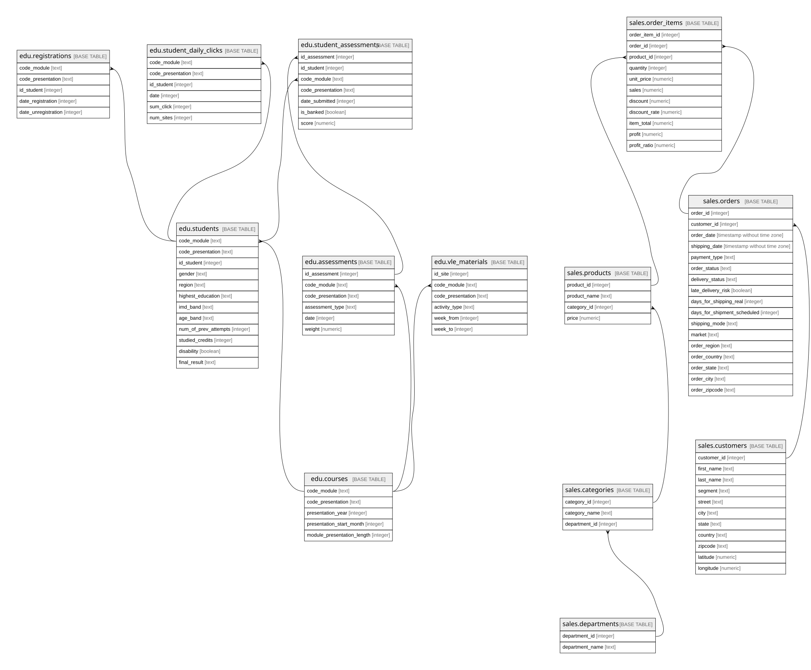

# company_demo

## Description

Cơ sở dữ liệu mẫu nhiều bảng dựng từ OULAD (schema edu) và DataCo (schema sales). Cách dựng ở data/postgres-demo/README.md.

## Viewpoints

| Name                        | Description                                                                                                    |
| --------------------------- | -------------------------------------------------------------------------------------------------------------- |
| [edu](viewpoint-edu.md)     | Dữ liệu học tập OULAD. Bảng sự kiện student_assessments và student_daily_clicks nối về students và courses.    |
| [sales](viewpoint-sales.md) | Dữ liệu bán hàng DataCo. Bảng sự kiện order_items nối về orders, customers, products, categories, departments. |

## Tables

| Name                                                    | Columns | Comment                                                                                                                                                       | Type       |
| ------------------------------------------------------- | ------- | ------------------------------------------------------------------------------------------------------------------------------------------------------------- | ---------- |
| [edu.courses](edu.courses.md)                           | 5       | Học phần: một môn mở trong một kỳ. Mỗi dòng một cặp (môn, kỳ)                                                                                                 | BASE TABLE |
| [edu.students](edu.students.md)                         | 12      | Sinh viên trong một học phần (từ studentInfo.csv). Mỗi dòng một sinh viên học một môn trong một kỳ                                                            | BASE TABLE |
| [edu.registrations](edu.registrations.md)               | 5       | Ngày đăng ký và ngày hủy đăng ký học phần của sinh viên (từ studentRegistration.csv). Mỗi dòng ứng với đúng một dòng edu.students                             | BASE TABLE |
| [edu.assessments](edu.assessments.md)                   | 6       | Bài đánh giá của một học phần: bài tập chấm bởi giảng viên, bài trắc nghiệm máy chấm, bài thi cuối kỳ                                                         | BASE TABLE |
| [edu.student_assessments](edu.student_assessments.md)   | 7       | Điểm từng bài đánh giá của sinh viên (từ studentAssessment.csv). Mỗi dòng một sinh viên nộp một bài                                                           | BASE TABLE |
| [edu.vle_materials](edu.vle_materials.md)               | 6       | Tài liệu và hoạt động trên hệ thống học trực tuyến (VLE) của một học phần (từ vle.csv)                                                                        | BASE TABLE |
| [edu.student_daily_clicks](edu.student_daily_clicks.md) | 6       | Số lần bấm trên hệ thống học trực tuyến của sinh viên theo ngày, gộp từ studentVle.csv. Mỗi dòng một sinh viên trong một học phần trong một ngày có hoạt động | BASE TABLE |
| [sales.departments](sales.departments.md)               | 2       | Phòng ban (nhóm hàng lớn) của cửa hàng                                                                                                                        | BASE TABLE |
| [sales.categories](sales.categories.md)                 | 3       | Danh mục sản phẩm; mỗi danh mục thuộc một phòng ban                                                                                                           | BASE TABLE |
| [sales.products](sales.products.md)                     | 4       | Sản phẩm; mỗi sản phẩm thuộc một danh mục                                                                                                                     | BASE TABLE |
| [sales.customers](sales.customers.md)                   | 11      | Khách hàng. Email và mật khẩu trong nguồn đã bị che (cùng một giá trị XXXXXXXXX) nên không đưa vào                                                            | BASE TABLE |
| [sales.orders](sales.orders.md)                         | 17      | Đơn hàng: ai đặt, khi nào, giao đi đâu, giao thế nào. Một đơn có một hoặc nhiều dòng hàng                                                                     | BASE TABLE |
| [sales.order_items](sales.order_items.md)               | 11      | Dòng hàng (bảng sự kiện): một sản phẩm trong một đơn, kèm số lượng, tiền, giảm giá, lợi nhuận. Mỗi dòng của file DataCo là một dòng ở đây                     | BASE TABLE |

## Relations

---

> Generated by [tbls](https://github.com/k1LoW/tbls)
