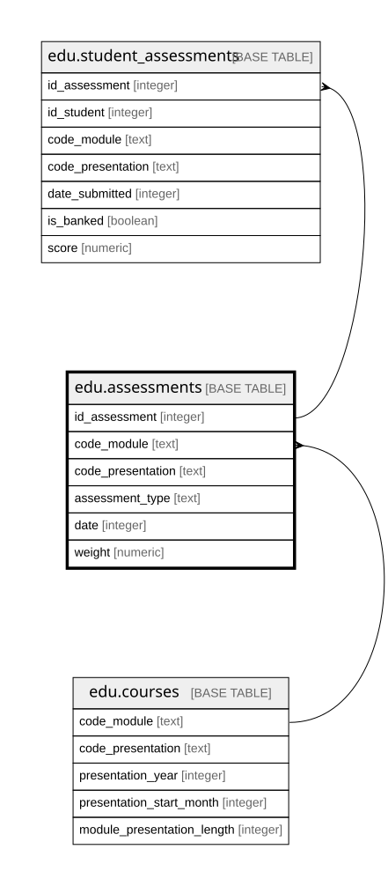

# edu.assessments

## Description

Bài đánh giá của một học phần: bài tập chấm bởi giảng viên, bài trắc nghiệm máy chấm, bài thi cuối kỳ

## Columns

| Name              | Type    | Default | Nullable | Children                                              | Parents                       | Comment                                                                                                                                                          |
| ----------------- | ------- | ------- | -------- | ----------------------------------------------------- | ----------------------------- | ---------------------------------------------------------------------------------------------------------------------------------------------------------------- |
| id_assessment     | integer |         | false    | [edu.student_assessments](edu.student_assessments.md) |                               | Mã bài đánh giá                                                                                                                                                  |
| code_module       | text    |         | false    |                                                       | [edu.courses](edu.courses.md) | Mã môn học                                                                                                                                                       |
| code_presentation | text    |         | false    |                                                       | [edu.courses](edu.courses.md) | Mã kỳ                                                                                                                                                            |
| assessment_type   | text    |         | false    |                                                       |                               | Loại bài: TMA (bài tập giảng viên chấm), CMA (bài máy chấm), Exam (thi cuối kỳ)                                                                                  |
| date              | integer |         | true     |                                                       |                               | Hạn nộp, tính bằng số ngày từ ngày bắt đầu học phần. Rỗng khi nguồn ghi "?" (bài thi chưa có ngày, theo mô tả OULAD là cuối học phần)                            |
| weight            | numeric |         | false    |                                                       |                               | Trọng số của bài, phần trăm. Trong một học phần, các bài không phải thi cộng lại 100 (môn GGG: 0) và bài thi cộng lại 100 (môn CCC có hai bài thi, cộng lại 200) |

## Viewpoints

| Name                    | Definition                                                                                                  |
| ----------------------- | ----------------------------------------------------------------------------------------------------------- |
| [edu](viewpoint-edu.md) | Dữ liệu học tập OULAD. Bảng sự kiện student_assessments và student_daily_clicks nối về students và courses. |

## Constraints

| Name                                           | Type        | Definition                                                                                          |
| ---------------------------------------------- | ----------- | --------------------------------------------------------------------------------------------------- |
| assessments_assessment_type_check              | CHECK       | CHECK ((assessment_type = ANY (ARRAY['TMA'::text, 'CMA'::text, 'Exam'::text])))                     |
| assessments_code_module_code_presentation_fkey | FOREIGN KEY | FOREIGN KEY (code_module, code_presentation) REFERENCES edu.courses(code_module, code_presentation) |
| assessments_pkey                               | PRIMARY KEY | PRIMARY KEY (id_assessment)                                                                         |

## Indexes

| Name             | Definition                                                                          |
| ---------------- | ----------------------------------------------------------------------------------- |
| assessments_pkey | CREATE UNIQUE INDEX assessments_pkey ON edu.assessments USING btree (id_assessment) |

## Relations

---

> Generated by [tbls](https://github.com/k1LoW/tbls)
