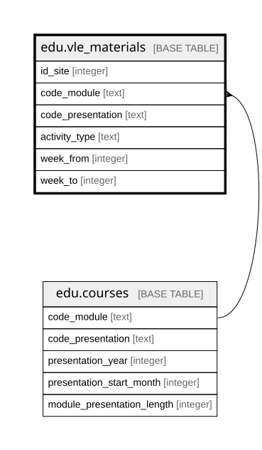

# edu.vle_materials

## Description

Tài liệu và hoạt động trên hệ thống học trực tuyến (VLE) của một học phần (từ vle.csv)

## Columns

| Name              | Type    | Default | Nullable | Children | Parents                       | Comment                                                                                                         |
| ----------------- | ------- | ------- | -------- | -------- | ----------------------------- | --------------------------------------------------------------------------------------------------------------- |
| id_site           | integer |         | false    |          |                               | Mã tài liệu                                                                                                     |
| code_module       | text    |         | false    |          | [edu.courses](edu.courses.md) | Mã môn học                                                                                                      |
| code_presentation | text    |         | false    |          | [edu.courses](edu.courses.md) | Mã kỳ                                                                                                           |
| activity_type     | text    |         | false    |          |                               | Loại hoạt động, ví dụ resource (tài liệu), forumng (diễn đàn), quiz (trắc nghiệm), oucontent (nội dung bài học) |
| week_from         | integer |         | true     |          |                               | Tuần dự kiến bắt đầu dùng tài liệu. Rỗng khi nguồn ghi "?"                                                      |
| week_to           | integer |         | true     |          |                               | Tuần dự kiến thôi dùng tài liệu. Rỗng khi nguồn ghi "?"                                                         |

## Viewpoints

| Name                    | Definition                                                                                                  |
| ----------------------- | ----------------------------------------------------------------------------------------------------------- |
| [edu](viewpoint-edu.md) | Dữ liệu học tập OULAD. Bảng sự kiện student_assessments và student_daily_clicks nối về students và courses. |

## Constraints

| Name                                             | Type        | Definition                                                                                          |
| ------------------------------------------------ | ----------- | --------------------------------------------------------------------------------------------------- |
| vle_materials_code_module_code_presentation_fkey | FOREIGN KEY | FOREIGN KEY (code_module, code_presentation) REFERENCES edu.courses(code_module, code_presentation) |
| vle_materials_pkey                               | PRIMARY KEY | PRIMARY KEY (id_site)                                                                               |

## Indexes

| Name               | Definition                                                                        |
| ------------------ | --------------------------------------------------------------------------------- |
| vle_materials_pkey | CREATE UNIQUE INDEX vle_materials_pkey ON edu.vle_materials USING btree (id_site) |

## Relations

---

> Generated by [tbls](https://github.com/k1LoW/tbls)
