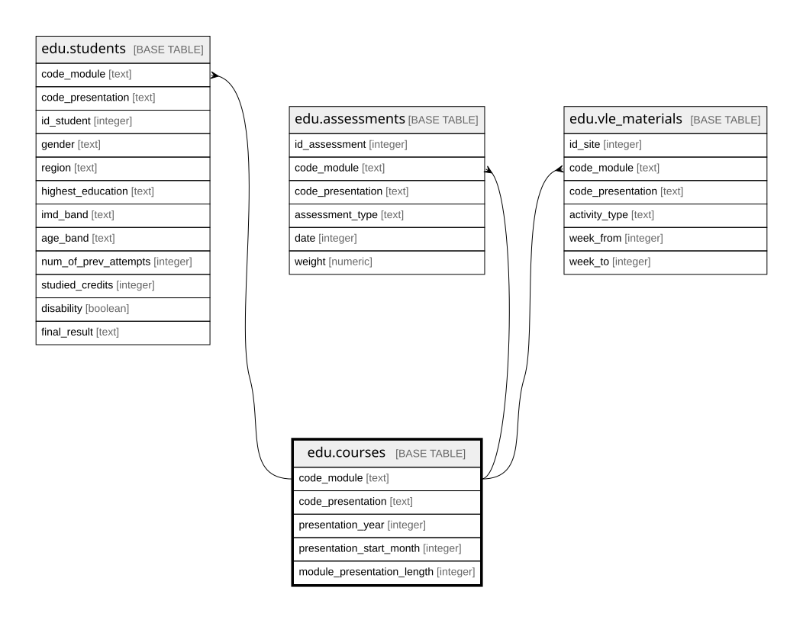

# edu.courses

## Description

Học phần: một môn mở trong một kỳ. Mỗi dòng một cặp (môn, kỳ)

## Columns

| Name                       | Type    | Default | Nullable | Children                                                                                                        | Parents | Comment                                                                             |
| -------------------------- | ------- | ------- | -------- | --------------------------------------------------------------------------------------------------------------- | ------- | ----------------------------------------------------------------------------------- |
| code_module                | text    |         | false    | [edu.students](edu.students.md) [edu.assessments](edu.assessments.md) [edu.vle_materials](edu.vle_materials.md) |         | Mã môn học, ví dụ AAA                                                               |
| code_presentation          | text    |         | false    | [edu.students](edu.students.md) [edu.assessments](edu.assessments.md) [edu.vle_materials](edu.vle_materials.md) |         | Mã kỳ mở môn: năm và chữ B (bắt đầu tháng 2) hoặc J (bắt đầu tháng 10), ví dụ 2013J |
| presentation_year          | integer |         | false    |                                                                                                                 |         | Năm bắt đầu kỳ, tách từ code_presentation                                           |
| presentation_start_month   | integer |         | false    |                                                                                                                 |         | Tháng bắt đầu kỳ: 2 với chữ B, 10 với chữ J, tách từ code_presentation              |
| module_presentation_length | integer |         | false    |                                                                                                                 |         | Độ dài học phần, tính bằng ngày                                                     |

## Constraints

| Name                                   | Type        | Definition                                              |
| -------------------------------------- | ----------- | ------------------------------------------------------- |
| courses_presentation_start_month_check | CHECK       | CHECK ((presentation_start_month = ANY (ARRAY[2, 10]))) |
| courses_pkey                           | PRIMARY KEY | PRIMARY KEY (code_module, code_presentation)            |

## Indexes

| Name         | Definition                                                                                   |
| ------------ | -------------------------------------------------------------------------------------------- |
| courses_pkey | CREATE UNIQUE INDEX courses_pkey ON edu.courses USING btree (code_module, code_presentation) |

## Relations

---

> Generated by [tbls](https://github.com/k1LoW/tbls)
