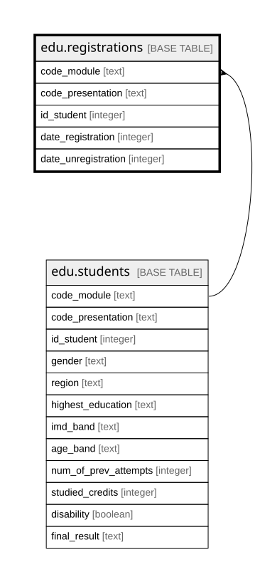

# edu.registrations

## Description

Ngày đăng ký và ngày hủy đăng ký học phần của sinh viên (từ studentRegistration.csv). Mỗi dòng ứng với đúng một dòng edu.students

## Columns

| Name                | Type    | Default | Nullable | Children | Parents                         | Comment                                                                                                    |
| ------------------- | ------- | ------- | -------- | -------- | ------------------------------- | ---------------------------------------------------------------------------------------------------------- |
| code_module         | text    |         | false    |          | [edu.students](edu.students.md) | Mã môn học                                                                                                 |
| code_presentation   | text    |         | false    |          | [edu.students](edu.students.md) | Mã kỳ                                                                                                      |
| id_student          | integer |         | false    |          | [edu.students](edu.students.md) | Mã sinh viên                                                                                               |
| date_registration   | integer |         | true     |          |                                 | Ngày đăng ký, tính bằng số ngày so với ngày bắt đầu học phần (âm là đăng ký trước). Rỗng khi nguồn ghi "?" |
| date_unregistration | integer |         | true     |          |                                 | Ngày hủy đăng ký, tính bằng số ngày so với ngày bắt đầu học phần. Rỗng nếu sinh viên không hủy                                             |

## Constraints

| Name                                                        | Type        | Definition                                                                                                                   |
| ----------------------------------------------------------- | ----------- | ---------------------------------------------------------------------------------------------------------------------------- |
| registrations_code_module_code_presentation_id_student_fkey | FOREIGN KEY | FOREIGN KEY (code_module, code_presentation, id_student) REFERENCES edu.students(code_module, code_presentation, id_student) |
| registrations_pkey                                          | PRIMARY KEY | PRIMARY KEY (code_module, code_presentation, id_student)                                                                     |

## Indexes

| Name               | Definition                                                                                                           |
| ------------------ | -------------------------------------------------------------------------------------------------------------------- |
| registrations_pkey | CREATE UNIQUE INDEX registrations_pkey ON edu.registrations USING btree (code_module, code_presentation, id_student) |

## Relations

---

> Generated by [tbls](https://github.com/k1LoW/tbls)
