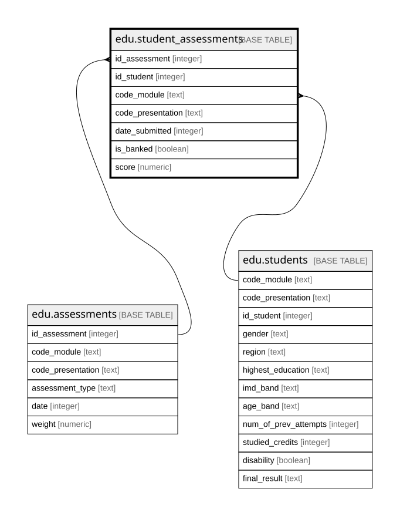

# edu.student_assessments

## Description

Điểm từng bài đánh giá của sinh viên (từ studentAssessment.csv). Mỗi dòng một sinh viên nộp một bài

## Columns

| Name              | Type    | Default | Nullable | Children | Parents                               | Comment                                                                            |
| ----------------- | ------- | ------- | -------- | -------- | ------------------------------------- | ---------------------------------------------------------------------------------- |
| id_assessment     | integer |         | false    |          | [edu.assessments](edu.assessments.md) | Mã bài đánh giá, khóa ngoại tới edu.assessments                                    |
| id_student        | integer |         | false    |          | [edu.students](edu.students.md)       | Mã sinh viên                                                                       |
| code_module       | text    |         | false    |          | [edu.students](edu.students.md)       | Mã môn học của bài đánh giá. Chép từ edu.assessments để có khóa ngoại tới edu.students |
| code_presentation | text    |         | false    |          | [edu.students](edu.students.md)       | Mã kỳ của bài đánh giá. Chép từ edu.assessments để có khóa ngoại tới edu.students  |
| date_submitted    | integer |         | false    |          |                                       | Ngày nộp, tính bằng số ngày từ ngày bắt đầu học phần                               |
| is_banked         | boolean |         | false    |          |                                       | Điểm chuyển từ lần học trước (true) hay làm trong lần này (false)                  |
| score             | numeric |         | true     |          |                                       | Điểm từ 0 đến 100; dưới 40 là trượt bài. Rỗng khi nguồn ghi "?"                    |

## Constraints

| Name                                                            | Type        | Definition                                                                                                                   |
| --------------------------------------------------------------- | ----------- | ---------------------------------------------------------------------------------------------------------------------------- |
| student_assessments_score_check                                 | CHECK       | CHECK (((score >= (0)::numeric) AND (score <= (100)::numeric)))                                                              |
| student_assessments_code_module_code_presentation_id_stude_fkey | FOREIGN KEY | FOREIGN KEY (code_module, code_presentation, id_student) REFERENCES edu.students(code_module, code_presentation, id_student) |
| student_assessments_id_assessment_fkey                          | FOREIGN KEY | FOREIGN KEY (id_assessment) REFERENCES edu.assessments(id_assessment)                                                        |
| student_assessments_pkey                                        | PRIMARY KEY | PRIMARY KEY (id_assessment, id_student)                                                                                      |

## Indexes

| Name                     | Definition                                                                                                      |
| ------------------------ | --------------------------------------------------------------------------------------------------------------- |
| student_assessments_pkey | CREATE UNIQUE INDEX student_assessments_pkey ON edu.student_assessments USING btree (id_assessment, id_student) |

## Relations

---

> Generated by [tbls](https://github.com/k1LoW/tbls)
