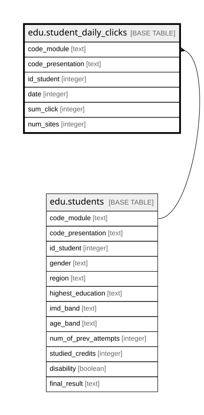

# edu.student_daily_clicks

## Description

Số lần bấm trên hệ thống học trực tuyến của sinh viên theo ngày, gộp từ studentVle.csv. Mỗi dòng một sinh viên trong một học phần trong một ngày có hoạt động

## Columns

| Name              | Type    | Default | Nullable | Children | Parents                         | Comment                                                                    |
| ----------------- | ------- | ------- | -------- | -------- | ------------------------------- | -------------------------------------------------------------------------- |
| code_module       | text    |         | false    |          | [edu.students](edu.students.md) | Mã môn học                                                                 |
| code_presentation | text    |         | false    |          | [edu.students](edu.students.md) | Mã kỳ                                                                      |
| id_student        | integer |         | false    |          | [edu.students](edu.students.md) | Mã sinh viên                                                               |
| date              | integer |         | false    |          |                                 | Ngày, tính bằng số ngày từ ngày bắt đầu học phần (âm là trước khi bắt đầu) |
| sum_click         | integer |         | false    |          |                                 | Tổng số lần bấm trong ngày, cộng trên mọi tài liệu                         |
| num_sites         | integer |         | false    |          |                                 | Số tài liệu khác nhau sinh viên mở trong ngày                              |

## Constraints

| Name                                                            | Type        | Definition                                                                                                                   |
| --------------------------------------------------------------- | ----------- | ---------------------------------------------------------------------------------------------------------------------------- |
| student_daily_clicks_code_module_code_presentation_id_stud_fkey | FOREIGN KEY | FOREIGN KEY (code_module, code_presentation, id_student) REFERENCES edu.students(code_module, code_presentation, id_student) |
| student_daily_clicks_pkey                                       | PRIMARY KEY | PRIMARY KEY (code_module, code_presentation, id_student, date)                                                               |

## Indexes

| Name                      | Definition                                                                                                                               |
| ------------------------- | ---------------------------------------------------------------------------------------------------------------------------------------- |
| student_daily_clicks_pkey | CREATE UNIQUE INDEX student_daily_clicks_pkey ON edu.student_daily_clicks USING btree (code_module, code_presentation, id_student, date) |

## Relations

---

> Generated by [tbls](https://github.com/k1LoW/tbls)
