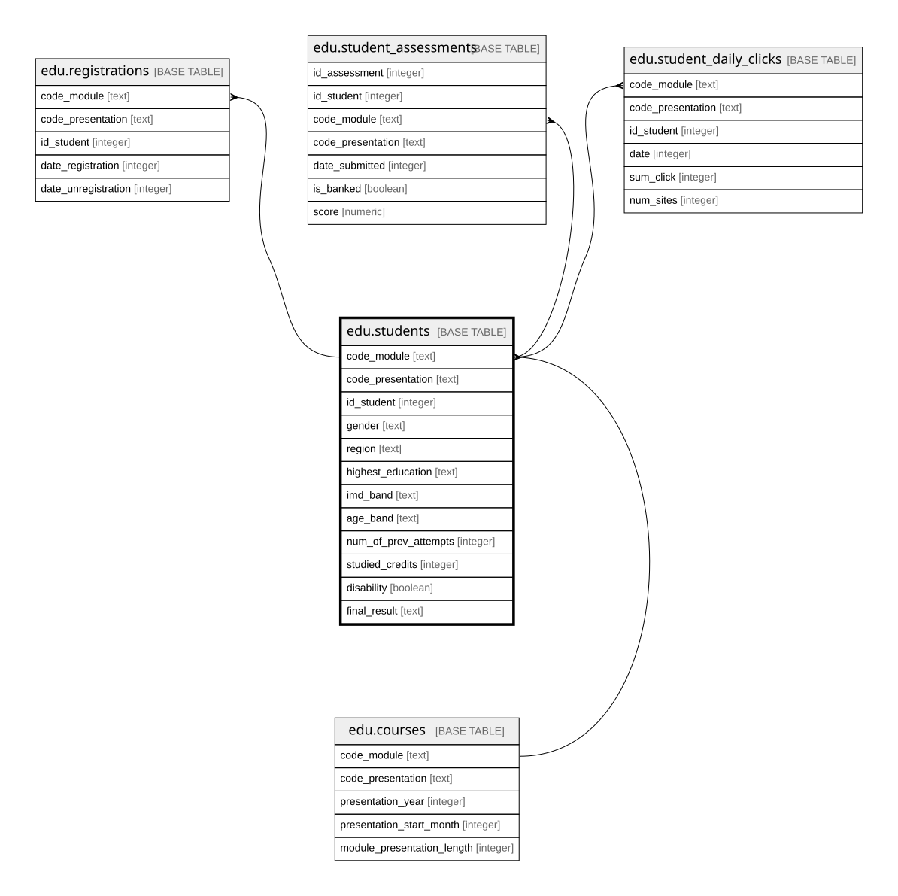

# edu.students

## Description

Sinh viên trong một học phần (từ studentInfo.csv). Mỗi dòng một sinh viên học một môn trong một kỳ

## Columns

| Name                 | Type    | Default | Nullable | Children                                                                                                                                                | Parents                       | Comment                                                                                                                                   |
| -------------------- | ------- | ------- | -------- | ------------------------------------------------------------------------------------------------------------------------------------------------------- | ----------------------------- | ----------------------------------------------------------------------------------------------------------------------------------------- |
| code_module          | text    |         | false    | [edu.registrations](edu.registrations.md) [edu.student_assessments](edu.student_assessments.md) [edu.student_daily_clicks](edu.student_daily_clicks.md) | [edu.courses](edu.courses.md) | Mã môn học                                                                                                              |
| code_presentation    | text    |         | false    | [edu.registrations](edu.registrations.md) [edu.student_assessments](edu.student_assessments.md) [edu.student_daily_clicks](edu.student_daily_clicks.md) | [edu.courses](edu.courses.md) | Mã kỳ                                                                                                                   |
| id_student           | integer |         | false    | [edu.registrations](edu.registrations.md) [edu.student_assessments](edu.student_assessments.md) [edu.student_daily_clicks](edu.student_daily_clicks.md) |                               | Mã sinh viên (đã ẩn danh). Một sinh viên có thể có nhiều dòng nếu học nhiều học phần                                                      |
| gender               | text    |         | false    |                                                                                                                                                         |                               | Giới tính: M nam, F nữ                                                                                                                    |
| region               | text    |         | false    |                                                                                                                                                         |                               | Vùng địa lý nơi sinh viên sống khi học                                                                                                    |
| highest_education    | text    |         | false    |                                                                                                                                                         |                               | Trình độ học vấn cao nhất khi vào học phần                                                                                                |
| imd_band             | text    |         | true     |                                                                                                                                                         |                               | Nhóm chỉ số thiếu thốn (Index of Multiple Deprivation) của nơi ở, theo khoảng phần trăm; 0-10% là thiếu thốn nhất. Rỗng khi nguồn ghi "?" |
| age_band             | text    |         | false    |                                                                                                                                                         |                               | Nhóm tuổi: 0-35, 35-55, 55\<=                                                                                                             |
| num_of_prev_attempts | integer |         | false    |                                                                                                                                                         |                               | Số lần đã học môn này trước đó                                                                                                            |
| studied_credits      | integer |         | false    |                                                                                                                                                         |                               | Tổng số tín chỉ sinh viên đang học trong kỳ                                                                                               |
| disability           | boolean |         | false    |                                                                                                                                                         |                               | Sinh viên có khai báo khuyết tật hay không                                                                                                |
| final_result         | text    |         | false    |                                                                                                                                                         |                               | Kết quả cuối học phần: Distinction (giỏi), Pass (đạt), Fail (trượt), Withdrawn (bỏ học)                                                   |

## Constraints

| Name                                        | Type        | Definition                                                                                               |
| ------------------------------------------- | ----------- | -------------------------------------------------------------------------------------------------------- |
| students_final_result_check                 | CHECK       | CHECK ((final_result = ANY (ARRAY['Distinction'::text, 'Pass'::text, 'Fail'::text, 'Withdrawn'::text]))) |
| students_gender_check                       | CHECK       | CHECK ((gender = ANY (ARRAY['M'::text, 'F'::text])))                                                     |
| students_code_module_code_presentation_fkey | FOREIGN KEY | FOREIGN KEY (code_module, code_presentation) REFERENCES edu.courses(code_module, code_presentation)      |
| students_pkey                               | PRIMARY KEY | PRIMARY KEY (code_module, code_presentation, id_student)                                                 |

## Indexes

| Name          | Definition                                                                                                 |
| ------------- | ---------------------------------------------------------------------------------------------------------- |
| students_pkey | CREATE UNIQUE INDEX students_pkey ON edu.students USING btree (code_module, code_presentation, id_student) |

## Relations

---

> Generated by [tbls](https://github.com/k1LoW/tbls)
