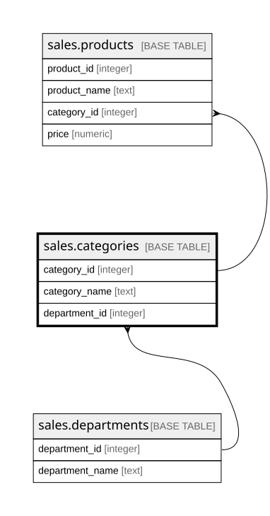

# sales.categories

## Description

Danh mục sản phẩm; mỗi danh mục thuộc một phòng ban

## Columns

| Name          | Type    | Default | Nullable | Children                            | Parents                                   | Comment                                                   |
| ------------- | ------- | ------- | -------- | ----------------------------------- | ----------------------------------------- | --------------------------------------------------------- |
| category_id   | integer |         | false    | [sales.products](sales.products.md) |                                           | Mã danh mục (Category Id, trùng Product Category Id)      |
| category_name | text    |         | false    |                                     |                                           | Tên danh mục, ví dụ Cleats, Fishing (Category Name)       |
| department_id | integer |         | false    |                                     | [sales.departments](sales.departments.md) | Phòng ban chứa danh mục, khóa ngoại tới sales.departments |

## Viewpoints

| Name                        | Definition                                                                                                     |
| --------------------------- | -------------------------------------------------------------------------------------------------------------- |
| [sales](viewpoint-sales.md) | Dữ liệu bán hàng DataCo. Bảng sự kiện order_items nối về orders, customers, products, categories, departments. |

## Constraints

| Name                          | Type        | Definition                                                              |
| ----------------------------- | ----------- | ----------------------------------------------------------------------- |
| categories_department_id_fkey | FOREIGN KEY | FOREIGN KEY (department_id) REFERENCES sales.departments(department_id) |
| categories_pkey               | PRIMARY KEY | PRIMARY KEY (category_id)                                               |

## Indexes

| Name            | Definition                                                                        |
| --------------- | --------------------------------------------------------------------------------- |
| categories_pkey | CREATE UNIQUE INDEX categories_pkey ON sales.categories USING btree (category_id) |

## Relations

---

> Generated by [tbls](https://github.com/k1LoW/tbls)
