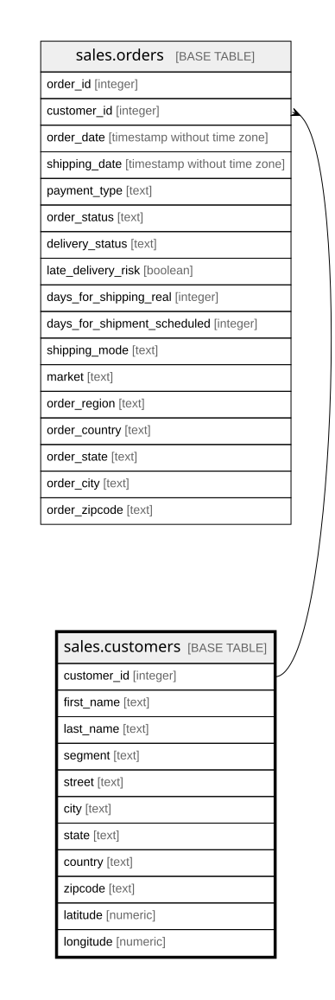

# sales.customers

## Description

Khách hàng. Email và mật khẩu trong nguồn đã bị che (cùng một giá trị XXXXXXXXX) nên không đưa vào

## Columns

| Name        | Type    | Default | Nullable | Children                        | Parents | Comment                                                                                                                        |
| ----------- | ------- | ------- | -------- | ------------------------------- | ------- | ------------------------------------------------------------------------------------------------------------------------------ |
| customer_id | integer |         | false    | [sales.orders](sales.orders.md) |         | Mã khách hàng (Customer Id, trùng Order Customer Id)                                                                           |
| first_name  | text    |         | false    |                                 |         | Tên (Customer Fname)                                                                                                           |
| last_name   | text    |         | true     |                                 |         | Họ (Customer Lname). Nguồn để trống ở 8 dòng                                                                                   |
| segment     | text    |         | false    |                                 |         | Phân khúc khách: Consumer (cá nhân), Corporate (doanh nghiệp), Home Office (văn phòng tại nhà)                                 |
| street      | text    |         | true     |                                 |         | Địa chỉ đường phố của khách. Trống ở 3 khách bị lệch cột trong nguồn (xem sql/sales_load.sql)                                  |
| city        | text    |         | false    |                                 |         | Thành phố nơi khách ở                                                                                                          |
| state       | text    |         | false    |                                 |         | Bang nơi khách ở, mã hai chữ, ví dụ CA, PR                                                                                     |
| country     | text    |         | false    |                                 |         | Nước nơi khách ở, như trong nguồn: EE. UU. (Hoa Kỳ) hoặc Puerto Rico                                                           |
| zipcode     | text    |         | true     |                                 |         | Mã bưu chính, như trong nguồn (số 0 ở đầu đã mất, ví dụ 725 là 00725). Không trống ở khách nào sau khi dời 3 khách bị lệch cột |
| latitude    | numeric |         | false    |                                 |         | Vĩ độ. Mô tả của DataCo gọi là vị trí cửa hàng, nhưng trong dữ liệu mỗi khách chỉ có một giá trị                               |
| longitude   | numeric |         | false    |                                 |         | Kinh độ, cùng ghi chú với latitude                                                                                             |

## Viewpoints

| Name                        | Definition                                                                                                     |
| --------------------------- | -------------------------------------------------------------------------------------------------------------- |
| [sales](viewpoint-sales.md) | Dữ liệu bán hàng DataCo. Bảng sự kiện order_items nối về orders, customers, products, categories, departments. |

## Constraints

| Name           | Type        | Definition                |
| -------------- | ----------- | ------------------------- |
| customers_pkey | PRIMARY KEY | PRIMARY KEY (customer_id) |

## Indexes

| Name           | Definition                                                                      |
| -------------- | ------------------------------------------------------------------------------- |
| customers_pkey | CREATE UNIQUE INDEX customers_pkey ON sales.customers USING btree (customer_id) |

## Relations

---

> Generated by [tbls](https://github.com/k1LoW/tbls)
