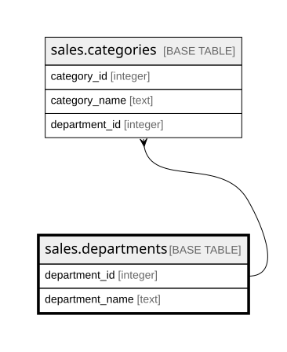

# sales.departments

## Description

Phòng ban (nhóm hàng lớn) của cửa hàng

## Columns

| Name            | Type    | Default | Nullable | Children                                | Parents | Comment                                                 |
| --------------- | ------- | ------- | -------- | --------------------------------------- | ------- | ------------------------------------------------------- |
| department_id   | integer |         | false    | [sales.categories](sales.categories.md) |         | Mã phòng ban (Department Id)                            |
| department_name | text    |         | false    |                                         |         | Tên phòng ban, ví dụ Fitness, Apparel (Department Name) |

## Viewpoints

| Name                        | Definition                                                                                                     |
| --------------------------- | -------------------------------------------------------------------------------------------------------------- |
| [sales](viewpoint-sales.md) | Dữ liệu bán hàng DataCo. Bảng sự kiện order_items nối về orders, customers, products, categories, departments. |

## Constraints

| Name             | Type        | Definition                  |
| ---------------- | ----------- | --------------------------- |
| departments_pkey | PRIMARY KEY | PRIMARY KEY (department_id) |

## Indexes

| Name             | Definition                                                                            |
| ---------------- | ------------------------------------------------------------------------------------- |
| departments_pkey | CREATE UNIQUE INDEX departments_pkey ON sales.departments USING btree (department_id) |

## Relations

---

> Generated by [tbls](https://github.com/k1LoW/tbls)
