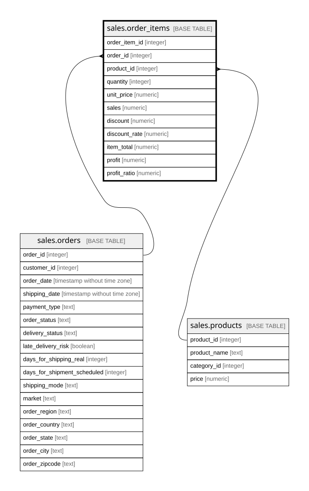

# sales.order_items

## Description

Dòng hàng (bảng sự kiện): một sản phẩm trong một đơn, kèm số lượng, tiền, giảm giá, lợi nhuận. Mỗi dòng của file DataCo là một dòng ở đây

## Columns

| Name          | Type    | Default | Nullable | Children | Parents                             | Comment                                                                                                                                                                        |
| ------------- | ------- | ------- | -------- | -------- | ----------------------------------- | ------------------------------------------------------------------------------------------------------------------------------------------------------------------------------ |
| order_item_id | integer |         | false    |          |                                     | Mã dòng hàng (Order Item Id)                                                                                                                                                   |
| order_id      | integer |         | false    |          | [sales.orders](sales.orders.md)     | Đơn chứa dòng hàng, khóa ngoại tới sales.orders                                                                                                                                |
| product_id    | integer |         | false    |          | [sales.products](sales.products.md) | Sản phẩm bán, khóa ngoại tới sales.products                                                                                                                                    |
| quantity      | integer |         | false    |          |                                     | Số lượng (Order Item Quantity)                                                                                                                                                 |
| unit_price    | numeric |         | false    |          |                                     | Đơn giá lúc bán, đô la Mỹ (Order Item Product Price). Trong dữ liệu luôn bằng sales.products.price                                                                             |
| sales         | numeric |         | false    |          |                                     | Doanh số trước giảm giá, bằng đơn giá nhân số lượng (Sales)                                                                                                                    |
| discount      | numeric |         | false    |          |                                     | Số tiền giảm giá (Order Item Discount)                                                                                                                                         |
| discount_rate | numeric |         | false    |          |                                     | Tỷ lệ giảm giá, từ 0 đến 1 (Order Item Discount Rate)                                                                                                                          |
| item_total    | numeric |         | false    |          |                                     | Thành tiền sau giảm giá (Order Item Total; cột Sales per customer trong nguồn có cùng giá trị ở mọi dòng)                                                                      |
| profit        | numeric |         | false    |          |                                     | Lợi nhuận của dòng hàng, có thể âm (Order Profit Per Order; cột Benefit per order có cùng giá trị ở mọi dòng). Tên nguồn nói "per order" nhưng giá trị đổi theo từng dòng hàng |
| profit_ratio  | numeric |         | false    |          |                                     | Tỷ suất lợi nhuận, bằng profit chia item_total (Order Item Profit Ratio)                                                                                                       |

## Viewpoints

| Name                        | Definition                                                                                                     |
| --------------------------- | -------------------------------------------------------------------------------------------------------------- |
| [sales](viewpoint-sales.md) | Dữ liệu bán hàng DataCo. Bảng sự kiện order_items nối về orders, customers, products, categories, departments. |

## Constraints

| Name                        | Type        | Definition                                                     |
| --------------------------- | ----------- | -------------------------------------------------------------- |
| order_items_product_id_fkey | FOREIGN KEY | FOREIGN KEY (product_id) REFERENCES sales.products(product_id) |
| order_items_order_id_fkey   | FOREIGN KEY | FOREIGN KEY (order_id) REFERENCES sales.orders(order_id)       |
| order_items_pkey            | PRIMARY KEY | PRIMARY KEY (order_item_id)                                    |

## Indexes

| Name             | Definition                                                                            |
| ---------------- | ------------------------------------------------------------------------------------- |
| order_items_pkey | CREATE UNIQUE INDEX order_items_pkey ON sales.order_items USING btree (order_item_id) |

## Relations

---

> Generated by [tbls](https://github.com/k1LoW/tbls)
