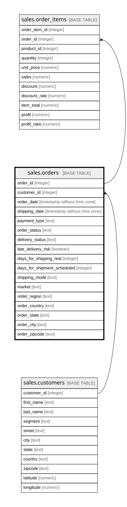

# sales.orders

## Description

Đơn hàng: ai đặt, khi nào, giao đi đâu, giao thế nào. Một đơn có một hoặc nhiều dòng hàng

## Columns

| Name                        | Type                        | Default | Nullable | Children                                  | Parents                               | Comment                                                                                                                                                                                    |
| --------------------------- | --------------------------- | ------- | -------- | ----------------------------------------- | ------------------------------------- | ------------------------------------------------------------------------------------------------------------------------------------------------------------------------------------------ |
| order_id                    | integer                     |         | false    | [sales.order_items](sales.order_items.md) |                                       | Mã đơn hàng (Order Id)                                                                                                                                                                     |
| customer_id                 | integer                     |         | false    |                                           | [sales.customers](sales.customers.md) | Khách đặt đơn, khóa ngoại tới sales.customers                                                                                                                                              |
| order_date                  | timestamp without time zone |         | false    |                                           |                                       | Thời điểm đặt hàng (order date (DateOrders))                                                                                                                                               |
| shipping_date               | timestamp without time zone |         | false    |                                           |                                       | Thời điểm giao hàng (shipping date (DateOrders))                                                                                                                                           |
| payment_type                | text                        |         | false    |                                           |                                       | Hình thức thanh toán: DEBIT, TRANSFER, CASH, PAYMENT (cột Type trong nguồn)                                                                                                                |
| order_status                | text                        |         | false    |                                           |                                       | Trạng thái đơn, ví dụ COMPLETE, PENDING, CANCELED, SUSPECTED_FRAUD                                                                                                                         |
| delivery_status             | text                        |         | false    |                                           |                                       | Tình trạng giao: Advance shipping (sớm), Shipping on time (đúng hạn), Late delivery (trễ), Shipping canceled (hủy)                                                                         |
| late_delivery_risk          | boolean                     |         | false    |                                           |                                       | Giao trễ hay không: true đúng với các đơn có delivery_status = Late delivery (Late_delivery_risk = 1). Đơn hủy (Shipping canceled) luôn là false, kể cả khi số ngày giao thực tế vượt lịch |
| days_for_shipping_real      | integer                     |         | false    |                                           |                                       | Số ngày giao thực tế                                                                                                                                                                       |
| days_for_shipment_scheduled | integer                     |         | false    |                                           |                                       | Số ngày giao theo lịch                                                                                                                                                                     |
| shipping_mode               | text                        |         | false    |                                           |                                       | Cách giao: Standard Class, Second Class, First Class, Same Day                                                                                                                             |
| market                      | text                        |         | false    |                                           |                                       | Thị trường nơi giao hàng: Africa, Europe, LATAM, Pacific Asia, USCA                                                                                                                        |
| order_region                | text                        |         | false    |                                           |                                       | Vùng nơi giao hàng, ví dụ Southeast Asia, Western Europe                                                                                                                                   |
| order_country               | text                        |         | false    |                                           |                                       | Nước nơi giao hàng, tên tiếng Tây Ban Nha như trong nguồn                                                                                                                                  |
| order_state                 | text                        |         | false    |                                           |                                       | Bang hoặc tỉnh nơi giao hàng                                                                                                                                                               |
| order_city                  | text                        |         | false    |                                           |                                       | Thành phố nơi giao hàng                                                                                                                                                                    |
| order_zipcode               | text                        |         | true     |                                           |                                       | Mã bưu chính nơi giao hàng. Nguồn chỉ có ở một phần đơn tại Hoa Kỳ, còn lại trống                                                                                                          |

## Constraints

| Name                    | Type        | Definition                                                        |
| ----------------------- | ----------- | ----------------------------------------------------------------- |
| orders_customer_id_fkey | FOREIGN KEY | FOREIGN KEY (customer_id) REFERENCES sales.customers(customer_id) |
| orders_pkey             | PRIMARY KEY | PRIMARY KEY (order_id)                                            |

## Indexes

| Name        | Definition                                                             |
| ----------- | ---------------------------------------------------------------------- |
| orders_pkey | CREATE UNIQUE INDEX orders_pkey ON sales.orders USING btree (order_id) |

## Relations

---

> Generated by [tbls](https://github.com/k1LoW/tbls)
