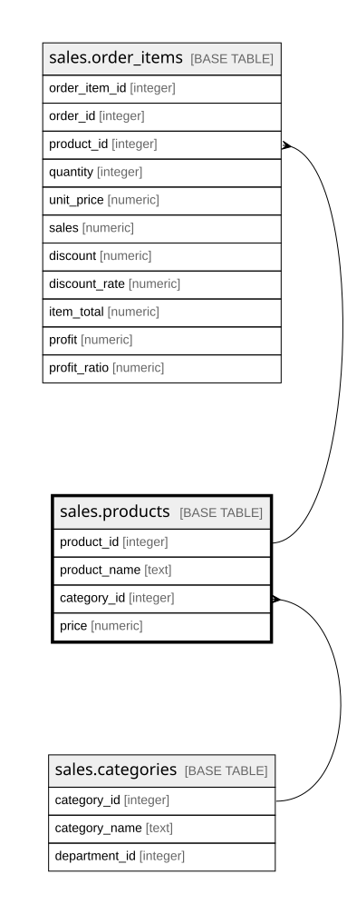

# sales.products

## Description

Sản phẩm; mỗi sản phẩm thuộc một danh mục

## Columns

| Name         | Type    | Default | Nullable | Children                                  | Parents                                 | Comment                                                     |
| ------------ | ------- | ------- | -------- | ----------------------------------------- | --------------------------------------- | ----------------------------------------------------------- |
| product_id   | integer |         | false    | [sales.order_items](sales.order_items.md) |                                         | Mã sản phẩm (Product Card Id, trùng Order Item Cardprod Id) |
| product_name | text    |         | false    |                                           |                                         | Tên sản phẩm (Product Name)                                 |
| category_id  | integer |         | false    |                                           | [sales.categories](sales.categories.md) | Danh mục của sản phẩm, khóa ngoại tới sales.categories      |
| price        | numeric |         | false    |                                           |                                         | Giá niêm yết của sản phẩm, đô la Mỹ (Product Price)         |

## Constraints

| Name                      | Type        | Definition                                                         |
| ------------------------- | ----------- | ------------------------------------------------------------------ |
| products_category_id_fkey | FOREIGN KEY | FOREIGN KEY (category_id) REFERENCES sales.categories(category_id) |
| products_pkey             | PRIMARY KEY | PRIMARY KEY (product_id)                                           |

## Indexes

| Name          | Definition                                                                   |
| ------------- | ---------------------------------------------------------------------------- |
| products_pkey | CREATE UNIQUE INDEX products_pkey ON sales.products USING btree (product_id) |

## Relations

---

> Generated by [tbls](https://github.com/k1LoW/tbls)
