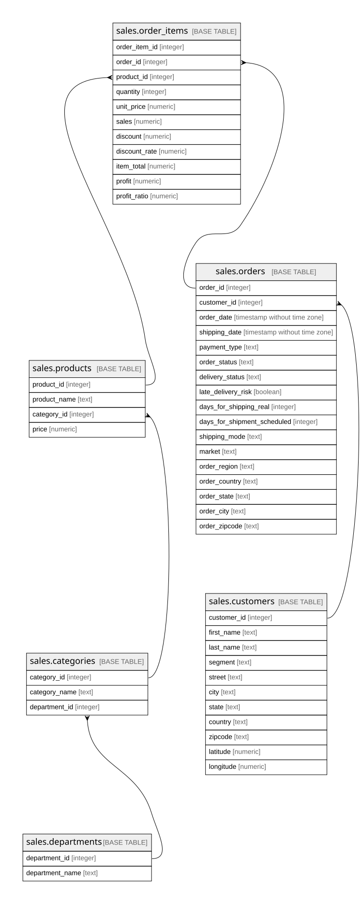

# sales

## Description

Dữ liệu bán hàng DataCo. Bảng sự kiện order_items nối về orders, customers, products, categories, departments.

## Tables

| Name                                      | Columns | Comment                                                                                                                                   | Type       |
| ----------------------------------------- | ------- | ----------------------------------------------------------------------------------------------------------------------------------------- | ---------- |
| [sales.departments](sales.departments.md) | 2       | Phòng ban (nhóm hàng lớn) của cửa hàng                                                                                                    | BASE TABLE |
| [sales.categories](sales.categories.md)   | 3       | Danh mục sản phẩm; mỗi danh mục thuộc một phòng ban                                                                                       | BASE TABLE |
| [sales.products](sales.products.md)       | 4       | Sản phẩm; mỗi sản phẩm thuộc một danh mục                                                                                                 | BASE TABLE |
| [sales.customers](sales.customers.md)     | 11      | Khách hàng. Email và mật khẩu trong nguồn đã bị che (cùng một giá trị XXXXXXXXX) nên không đưa vào                                        | BASE TABLE |
| [sales.orders](sales.orders.md)           | 17      | Đơn hàng: ai đặt, khi nào, giao đi đâu, giao thế nào. Một đơn có một hoặc nhiều dòng hàng                                                 | BASE TABLE |
| [sales.order_items](sales.order_items.md) | 11      | Dòng hàng (bảng sự kiện): một sản phẩm trong một đơn, kèm số lượng, tiền, giảm giá, lợi nhuận. Mỗi dòng của file DataCo là một dòng ở đây | BASE TABLE |

## Relations

---

> Generated by [tbls](https://github.com/k1LoW/tbls)
