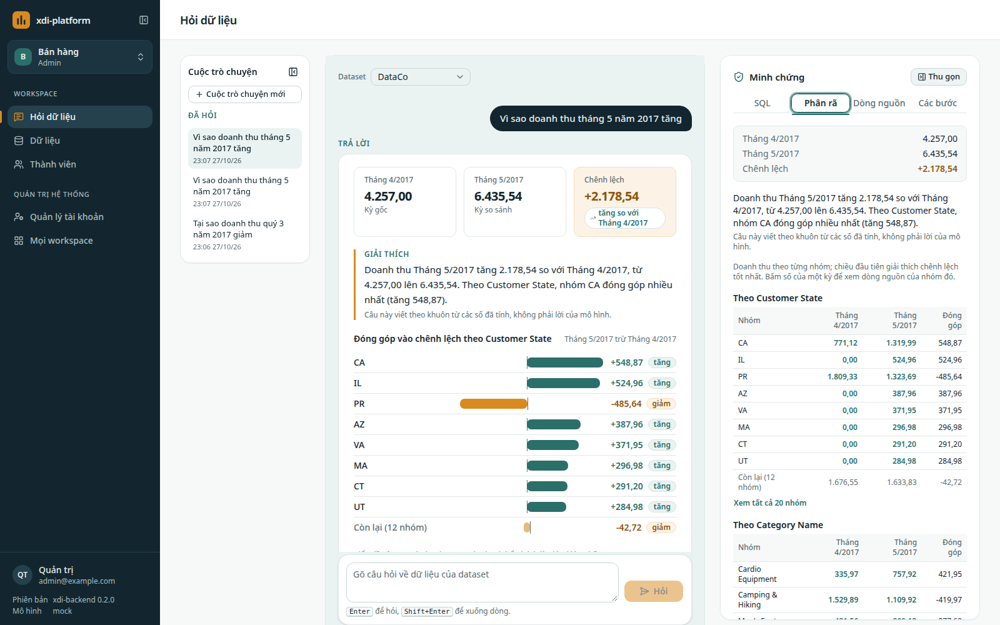
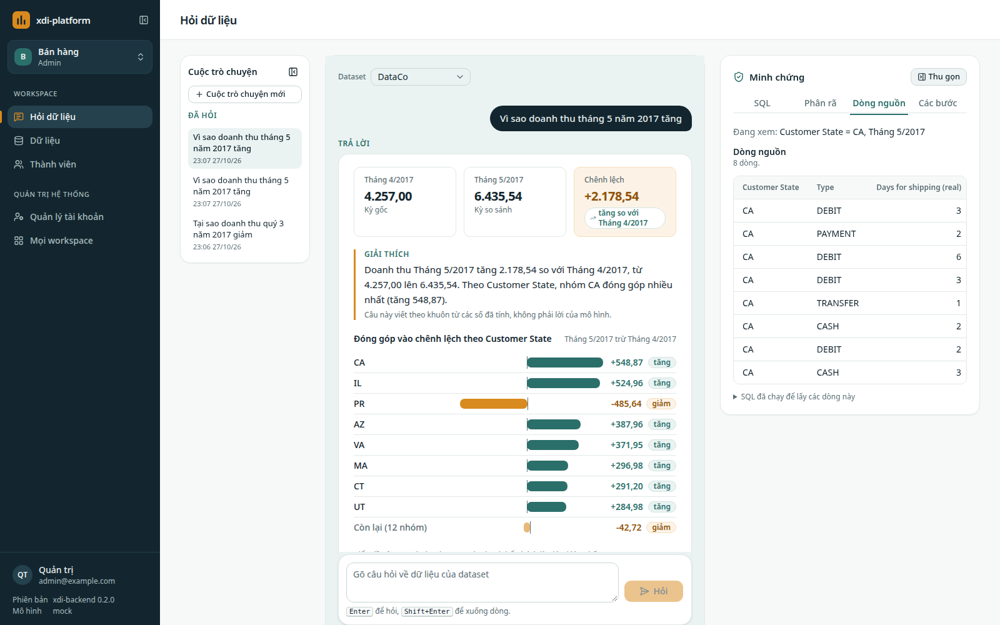

# xdi-platform

*Natural language data analysis, in development; the latest release is v0.2.0. Upload a CSV, Parquet or Excel file, ask a question in Vietnamese, and get a table, a chart and the SQL that produced it, checked by a SQL guard before it runs. For "why" questions, the engine computes which groups drove the change and shows the source rows behind each group. Rust backend, DuckDB for analytics, Postgres for application data, React UI. Apache 2.0. Vietnamese documentation follows.*

Nạp một file dữ liệu, hỏi bằng tiếng Việt, nhận bảng, biểu đồ và câu SQL đã chạy. Với câu hỏi "tại sao", hệ thống tính
nhóm nào làm con số tăng hay giảm và cho xem các dòng dữ liệu đứng sau từng nhóm. Con số do engine phân tích tính trên
dữ liệu; mô hình ngôn ngữ chỉ viết SQL hay điền form từ câu hỏi, viết mô tả cột và lời giải thích, không nhận các dòng
dữ liệu ([Dữ liệu và quyền riêng tư](PRIVACY.md)).

## Luồng câu "tại sao"

Ảnh chụp trên dataset mẫu DataCo với mô hình `mock`. Hỏi "Vì sao doanh thu tháng 5 năm 2017 tăng": thẻ trả lời ghi hai
kỳ, chênh lệch, lời giải thích và phần đóng góp của từng nhóm; pane Minh chứng bên phải có bảng phân rã theo từng chiều.



Bấm một số trong bảng phân rã (ở đây doanh thu của bang CA trong tháng 5/2017) để xem các dòng dữ liệu đứng sau số đó.



## Trạng thái

Đã có: tài khoản, workspace và hai vai `admin`, `member`; nạp CSV, Parquet, Excel thành phiên bản, xóa dataset, hồ sơ
cột và câu hỏi gợi ý; dataset mẫu DataCo nạp sẵn khi thiết lập lần đầu; hỏi dữ liệu ra SQL qua guard, bảng, biểu đồ cột
hoặc đường, thẻ "Đã hiểu là", pane bằng chứng với câu SQL và các bước đã chạy; câu "tại sao" có bảng phân rã và lời
giải thích; bấm một số của bảng kết quả hay bảng phân rã để xem dòng nguồn; mô hình ngôn ngữ `mock`, Gemini, Ollama.

Chưa có: gán vai dữ liệu để lọc dòng, chế độ demo, màn xem lịch sử câu hỏi, màn sửa hồ sơ cột và chỉ số. Danh
sách đầy đủ ở [README](https://github.com/pgiahuy/xdi-platform#trạng-thái) và bảng Trạng thái của
[Kiến trúc](ARCHITECTURE.md#trạng-thái).

## Chạy

```bash
git clone https://github.com/pgiahuy/xdi-platform.git
cd xdi-platform
cp .env.example .env
docker compose up --build
```

Mở http://localhost:8000; lần đầu, nhập mã thiết lập in trong log của backend
(`docker compose logs backend | grep setup_code`) để tạo tài khoản quản trị và workspace đầu tiên.
`curl localhost:8000/api/health` trả `{"status":"ok"}`. Từ màn thiết lập tới câu trả lời đầu tiên: mục 7 của
[Cài đặt](INSTALL.md). Tiến độ ở [milestones](https://github.com/pgiahuy/xdi-platform/milestones).

## Tài liệu

- [Kiến trúc](ARCHITECTURE.md): sơ đồ, luồng một câu hỏi, hai kho dữ liệu, hướng phát triển.
- [Cài đặt](INSTALL.md): Docker, build từ nguồn, đưa lên Internet với HTTPS, sao lưu, lỗi hay gặp.
- [Phát hành](RELEASING.md): quy trình ra phiên bản mới.
- [Giấy phép](LICENSES.md): giấy phép của các thành phần bên thứ ba.
- [Dữ liệu và quyền riêng tư](PRIVACY.md): dữ liệu nằm ở đâu, gửi gì cho mô hình ngôn ngữ, cách xóa.
- [API](API.md): đặc tả OpenAPI, đăng nhập bằng cookie, workspace và vai, mã lỗi.
- [Guard SQL](GUARD.md): câu SQL nào được chạy, câu nào bị từ chối, các ca đã có test.
- [Dữ liệu](DATA.md): định dạng file nhận, giới hạn, phiên bản, tên bảng và tên cột.
- [Gói khái niệm ngành](DOMAINS.md): khái niệm chung của một ngành, schema của file gói, cách thêm một ngành.

## Tham gia

- Lỗi: [Issues](https://github.com/pgiahuy/xdi-platform/issues).
- Câu hỏi và ý tưởng: [Discussions](https://github.com/pgiahuy/xdi-platform/discussions).
- Đóng góp mã: [CONTRIBUTING.md](https://github.com/pgiahuy/xdi-platform/blob/main/CONTRIBUTING.md).
- Lỗ hổng bảo mật: báo riêng theo [SECURITY.md](https://github.com/pgiahuy/xdi-platform/blob/main/SECURITY.md), không
  mở issue công khai.
